  

Hi, I'm Gavio. I studied Computer Science at the University of Ferrara and I'm going deeper with an MSc in Cybersecurity.

Usually I build microservices held together with Docker. On my own time I tend to go down a level, to see what sits under the abstractions I use every day. Then I try to break what I built.

### Down the stack

| depth | project | what it is |
| :---: | --- | --- |
| `-1/-2` | [blog-post-benchmark](https://github.com/gvnlnz/blog-post-benchmark) | Local LLMs writing Italian articles: Ollama, FastAPI, Laravel jobs |
| `-1` | [Briscola](https://github.com/gvnlnz/Briscola) | The Italian card game, in the browser |
| `-1/-2` | [RESTful-API](https://github.com/gvnlnz/RESTful-API) | A Node.js + Express API |
| `0/-3` | [redis-clone](https://github.com/gvnlnz/redis-clone) | The RESP protocol, reimplemented in C |
| `-3` | [file-compressor](https://github.com/gvnlnz/file-compressor) | A file compressor in C |
| `0/-3` | [libc-reconstructions](https://github.com/gvnlnz/libc-reconstructions) | Standard library functions, rebuilt from scratch |
| `0/-3` | [Client-Server](https://github.com/gvnlnz/Client-Server) | Socket exercises in C |

### Lately

- Solved 60+ challenges at [CyberChallenge.IT](https://cyberchallenge.it): web security, network security, Linux.
- Self-hosting on a Raspberry Pi: Pi-hole with Unbound and a few things that used to live in someone else's cloud.

  <a href="https://lorenzogaviani.it"><b>lorenzogaviani.it</b></a>

